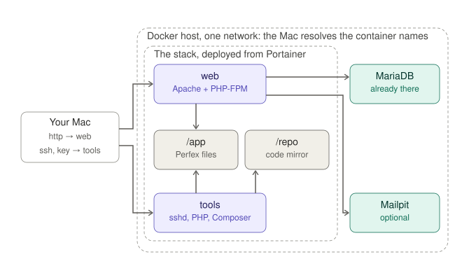

# Perfex CRM Stack Docker: a test instance for Perfex CRM, on a Docker server

A template for trying Perfex CRM and its modules (and PHP code around them) on a **real instance on a Docker server**, from your machine,
with the PHP matrix, integration tests and throw-away snapshots, reachable through **one single door**: a service container with
SSH, key only. The stack runs on Portainer; you paste one compose file (or point a Git repository stack at it), and a small
generator writes the scripts and documents for your project.

It also works for an AI agent with a shell on your machine (Claude Code, Codex, Copilot in agent mode or another): the agent gets
the scripts, a prompt and a section for its instruction file (`AGENTS.md`, `CLAUDE.md` or `.github/copilot-instructions.md`),
never root, Portainer, the Docker socket or your database password. A cloud agent reads the rules but has no SSH key and no
route to the Docker network. See `ai/`.

**Perfex CRM is not part of this repository and never will be.** It is proprietary: you bring your own licensed copy
(`install-perfex.sh` copies it to the server); if you do not own a license yet, buy it on CodeCanyon:
https://codecanyon.net/item/perfex-powerful-open-source-crm/14013737. The example module and its tests are written from scratch.

## 1. The reference infrastructure

The template documents the setup it was built on, as a reference. Adapt it, or keep the same shape:

| Piece | What the template assumes |
|---|---|
| A Docker host | with Portainer to deploy the stack. Tested on Portainer **Business Edition** (November 2026); the compose file uses no Business-only feature (no relative volume paths, see §4), but Community Edition has not been tried |
| An external Docker network | for example `containers`, whose container names also resolve **on your machine** (a DNS entry such as `*.docker` pointing at the host; your machine reaches the containers by name: no port is published) |
| MariaDB | already running on the server (the template does not create it): a database and a user for this instance |
| Mailpit (optional) | already running on the server, for the application's test mail |
| Your machine | bash 3.2 or later, ssh, rsync, curl, perl (all in macOS; Linux works, Windows only through WSL and untested) |
| Root on the server | for a handful of one-time steps (folders, images). Daily use needs none |

<picture>
  <source media="(prefers-color-scheme: dark)" srcset="docs/reference-infrastructure-dark.svg">
  
</picture>

The tools container has PHP 8.1 to 8.5, Composer, rsync and the MariaDB client: the snapshots and the lock live there. The
web container serves `/app` and talks to MariaDB and, for the test mail, to Mailpit, whose web interface your machine opens too.
No port is published: your machine reaches both containers by name, over the Docker network.

## 2. What is in the folder

```
perfex-crm-stack/
├── README.md              this file
├── LICENSE                MIT
├── CHANGELOG.md           what changed in each version of the template
├── params.example.env     every parameter, commented, with its neutral default
├── render.sh              --check validates the parameters; otherwise it writes the PROJECT FOLDER (never stack/)
├── docs/                  the diagram of §1 as SVG, a light and a dark variant (GitHub picks one with the reader's theme)
├── stack/                 used as it is: paste into Portainer, or point a Git repository stack at it
│   ├── README.md          the compose file, the variables, the two images, the optional second web instance
│   ├── docker-compose.yml web + tools; stack variables with defaults; no build:, no secrets, no relative paths
│   ├── web-extra.yml      optional second web instance (another PHP version)
│   ├── web/               the build context of the web image (built on the server, one per PHP version)
│   │   ├── Dockerfile               php:<PHP_VERSION>-fpm with Apache in front and the extensions Perfex needs; installer pinned by version and SHA-256
│   │   ├── entrypoint.sh            PHP-FPM in the background, Apache as process 1; PASS_AUTHORIZATION=1 writes CGIPassAuth On
│   │   ├── apache/000-default.conf  the virtual host: PHP over proxy_fcgi to 127.0.0.1:9000, no directory listing
│   │   └── php/uploads.ini          file_uploads On, memory_limit 128M, upload and post 64M, max_execution_time 30
│   ├── tools.Dockerfile   PHP versions from Sury, Composer, sshd, rsync, MariaDB client, optional Node
│   └── tools/             the two files the tools image copies
│       ├── entrypoint.sh            persistent host keys, the stack variables in every SSH session, optional forwarding, sshd in the foreground
│       └── sshd_config              www-data only, key only, no root, no password, no forwarding; the Include stays the first line
├── project/               the MODEL of the folder render.sh writes into your project (the only place with your values)
│   ├── README.md          the runbook of your instance, with your values filled in
│   ├── stack.conf         the values of your project, read by every script below
│   ├── portainer.env      the stack variables to load in Portainer (the four PERFEX_DB_* empty: you type them there)
│   ├── lib.sh             shared helpers and validators, sourced by the other scripts (and by yours in extra/)
│   ├── sync.sh            mirrors your code folder to /repo/<SYNC_DIR> on the server, and puts locked.sh there
│   ├── deploy.sh          sync, then copies a module into the application in development mode (.stack-managed marker, --adopt)
│   ├── ci-local.sh        the PHP matrix on the server: composer install, validate --strict, your check script, per version
│   ├── run.sh             one command on the server, inside the lock
│   ├── doctor.sh          checks the stack from your machine; --guide prints the setup steps with your values
│   ├── snapshot.sh        a dump of the database and an archive of /app, kept on the server
│   ├── reset.sh           puts a snapshot back, after you type its name (--list shows them)
│   ├── install-perfex.sh  copies your Perfex CRM (a folder or a zip) into /app
│   ├── locked.sh          runs on the server: one heavy job at a time (flock), low priority, its process group ended with the job
│   ├── extra/             README.md only: your own scripts, never touched by render.sh --force
│   └── tests/             four tests with a fake ssh, rsync and curl: no server is touched
│       ├── deploy-test.sh           deploy.sh from your machine, and its server script against a folder tree
│       ├── locked-test.sh           run.sh and locked.sh
│       ├── scripts-test.sh          ci-local.sh, snapshot.sh, reset.sh, install-perfex.sh, doctor.sh and the scripts of examples/extra/ (fake git and npx too)
│       └── render-test.sh           render.sh with good and bad parameters (it finds the template through TEMPLATE_REL, or STACK_TEMPLATE_DIR)
├── examples/              neutral examples: a parameter file, a module, three scripts for extra/
│   ├── params/example.env       a filled-in parameter file with neutral values
│   ├── module/sample_module/    the smallest module that goes through all of it, with unit and integration tests
│   └── extra/                   scripts to copy into the generated extra/ folder (tested by scripts-test.sh)
│       ├── infection-diff.sh    Infection on the changed files of a module, on the server, inside the lock
│       ├── bench.sh             response times of one URL from your machine, with percentiles
│       └── e2e.sh               a Playwright suite of your project against the instance
└── ai/                    optional (INCLUDE_AI=1): what an AI agent with a shell gets, rendered with your values
    ├── PROMPT.md          two ready prompts: connect to a stack that already runs, or build a new one
    ├── AGENTS-section.md  the section for the agent's instruction file (AGENTS.md; CLAUDE.md for Claude Code; copilot-instructions.md for Copilot Chat)
    └── memory-note.md     a memory note for Claude Code: addresses, scripts, what it never asks for
```

## 3. Quick start

Put the template in your project as `perfex-crm-stack/`, the name a clone gets (the paths below use it; with another name,
change them). From the **project root**, one of the two:

```bash
git clone https://github.com/antwal/perfex-crm-stack.git
```

```bash
git submodule add https://github.com/antwal/perfex-crm-stack.git perfex-crm-stack
```

A clone or a copy is not part of your repository: ignore it in your `.gitignore`, together with the temporary folder of
the scripts (`LOCAL_TMP_DIR`, `.tmp` by default) and your copy of Perfex CRM if it sits in the project (the folder or the
zip you give `install-perfex.sh`: it is proprietary and never goes in a repository). A submodule is recorded by git itself:
do not ignore it.

```gitignore
/perfex-crm-stack/
/.tmp/
# your copy of Perfex CRM, folder or zip, by its real name
/perfex-crm/
/perfex_crm_*.zip
```

Then:

```bash
cp perfex-crm-stack/params.example.env perfex-crm-stack/params.env
$EDITOR perfex-crm-stack/params.env                             # names, DNS names, folders: at least the six REQUIRED values
perfex-crm-stack/render.sh --check perfex-crm-stack/params.env  # validates everything, writes nothing
perfex-crm-stack/render.sh perfex-crm-stack/params.env .        # writes ./tools/docker/ (DEST_DIR): scripts, stack.conf, portainer.env, README
```

`render.sh` refuses to write into a folder that is not empty unless you pass `--force`, and with `--force` it replaces only
the files it generates. Then follow `tools/docker/README.md`: it has your values in every command. In short: a key and an
SSH alias on your machine (its step 1: `ssh-keygen` and the `~/.ssh/config` block; `stack/README.md` repeats them for whoever uses
`stack/` alone); on the server, as root, a few folders, the authorized key, and the two images built from `stack/`;
the stack in Portainer; `tools/docker/doctor.sh`; your copy of Perfex with `tools/docker/install-perfex.sh`.

Step 1 of that README, shown here with the names of `params.example.env` (`SSH_ALIAS` `myproject-test`, `TOOLS_HOST`
`myproject-tools.perfexcrm.docker`; the generated README has yours):

```bash
ssh-keygen -t ed25519 -f ~/.ssh/myproject-test -C myproject-test -N ""
```

```bash
cat >> ~/.ssh/config <<'EOT'

Host myproject-test
    HostName myproject-tools.perfexcrm.docker
    Port 2222
    User www-data
    IdentityFile ~/.ssh/myproject-test
    IdentitiesOnly yes
EOT
```

```bash
cat ~/.ssh/myproject-test.pub
```

The line it prints goes into `<REMOTE_ROOT>/tools/authorized_keys` on the server (step 3 of the generated README). The private
key never leaves your machine and is never pasted into a chat.

The parameter file is a bash file that `render.sh` sources, so it is code: keep it out of version control if it holds
anything you would not publish. It never holds a secret: the database credentials are stack variables you type in Portainer.

### The parameters, by theme

All are in `params.example.env` with comments; `render.sh --check` explains every refusal.

| Theme | Parameters |
|---|---|
| Identity and network | `PROJECT_LABEL`, `STACK_NAME`, `DOCKER_NETWORK`, `APP_HOST`, `TOOLS_HOST`, `APP_URL`, `SSH_ALIAS` |
| Server and images | `REMOTE_ROOT`, `TZ`, `WEB_PHP_VERSION`, `IMAGE_OWNER` (optional prefix: the images are `[<owner>/]perfex-web:<PHP version>` and `[<owner>/]perfex-tools:<first>-<last PHP version>`), `WEB_IMAGE` and `TOOLS_IMAGE` (only to override those names), `TOOLS_PHP_VERSIONS`, `TOOLS_NODE`, `PASS_AUTHORIZATION`, `TOOLS_CPUS`, `TOOLS_MEM`, `TOOLS_PIDS`, `WEB_EXTRA_*` |
| Where things go | `DEST_DIR` (the generated folder), `LOCAL_TMP_DIR`, `SYNC_DIR` (the code mirrored to the server), `LOCK_FILE`, `SYNC_EXCLUDES` |
| Modules and CI | `MODULES_DIR`, `APP_TARGETS`, `DEPLOY_MODULES`, `DEPLOY_EXTRA` (modules that live deeper than `<SYNC_DIR>/<name>/`, as `<folder>:<name>` pairs), `DEPLOY_EXCLUDES`, `DEV_MARKER`, `CI_MODULES`, `CI_CHECK_SCRIPT`, `CI_STATIC_SCRIPT`, `STATIC_TOOLS_DIR` |
| PHP versions | `MATRIX_PHP_VERSIONS` (default `8.3 8.4 8.5`), `DEFAULT_PHP` (8.4), `STATIC_PHP`, `DEPLOY_PHP` |
| Services and agents | `MAILPIT_URL`, `MAILPIT_SMTP_HOST`, `MAILPIT_SMTP_PORT`, `INCLUDE_AI` |

## 4. Portainer: web editor or Git repository

The compose file in `stack/` is the same for everyone. Portainer substitutes `${VAR}` and `${VAR:-default}` with the stack's
variables in both methods, without changing the file. The field names below follow Portainer's documentation (*Add a new stack*,
*Edit a stack*); check them against the version you run.

**Web editor.** *Stacks > Add stack > Web editor*: paste `stack/docker-compose.yml`. In *Environment variables* use
*Load variables from .env file* with the project folder's `portainer.env`, then type the values of the four `PERFEX_DB_*`
variables, which the file brings in empty.
To change the compose file later: *Editor*, paste, *Update the stack*.

**Git repository.** *Stacks > Add stack > Repository*:

- the repository: in recent Portainer versions it is chosen as a preconfigured **Source** (a URL and its credentials, set once);
  older versions have the URL and *Authentication* directly in the form. For a private repository, give Portainer a
  **read-only** token;
- *Repository reference*: a **tag** (`refs/tags/<tag>`) of the version of this template you use, not a branch, so that
  updating the template never redeploys anyone's instance by itself;
- *Compose path*: `stack/docker-compose.yml`; *Additional paths*: `stack/web-extra.yml` if you use the second web instance;
- *GitOps updates*: off (use *Pull and redeploy* by hand);
- the variables work as above. Everything you would put in the compose file stays in the stack variables, because **a Git
  stack's compose file cannot be edited in Portainer** (and *Detach from Git* is irreversible).

Two limits shaped the file: volumes with **relative paths** need Portainer's Business Edition, so every host path starts
from `${REMOTE_ROOT}`; and **`build:`** does not work for remote environments (a known Portainer issue), so the two images are built on the
server beforehand and the compose file names them. That is why `authorized_keys` and an optional `uploads.ini` sit on the
host and not in the repository.

**No route to the Docker network?** The compose file publishes no port (`expose:` only), which suits the reference infrastructure
of section 1. If your machine does not resolve the network's names or cannot reach it, add `ports:` for the web (80) and for sshd
(the `SSH_PORT`, 2222 by default), choose two free host ports, and point `APP_URL` and the alias's `HostName` and `Port` at the
host: `stack/README.md` has the two blocks to add and the details. The compose file in the repository does not change.

## 5. The two images, built by you

Both are built on the server, as root, from the `stack/` folder (the project README prints the commands with your values):

- **web**: `php:<PHP_VERSION>-fpm` with Apache in front, the extensions Perfex needs (`mysqli pdo_mysql gd curl mbstring iconv zip imap`;
  the official images no longer ship `imap`, which Perfex's installer requires), the production `php.ini`, upload limits, no
  directory listings, logs on stdout/stderr, Apache as process 1 so a stop is immediate, PHP-FPM on the loopback only. The
  extension installer is pinned by version **and** SHA-256. For another PHP version build again with another `PHP_VERSION`.
- **tools**: Debian with PHP from the Sury repository (default 8.1 to 8.5, one `/opt/php/<version>/php` shim each), Composer
  (pinned), sshd, rsync, git, jq, the MariaDB client, and Node if you ask (`TOOLS_NODE=1`, pinned, x86-64 only).

You can bring your own web image: set `WEB_IMAGE`. The template publishes no image.

## 6. Daily use, in one table

From the project root; every command has the values of your project (`tools/docker/` is the default `DEST_DIR`).

| Command | Effect |
|---|---|
| `tools/docker/sync.sh` | mirror your code folder to `/repo/<SYNC_DIR>` on the server, and put `locked.sh` there |
| `tools/docker/deploy.sh [--adopt] <module> [<target>]` | sync, then copy a module into `/app/modules/<module>`: refuses a folder that does not hold the `.stack-managed` marker unless `--adopt` |
| `tools/docker/ci-local.sh [<module> ...]` | the PHP matrix: install, validate, your `check` script, on every version |
| `tools/docker/run.sh '<command>'` | one command on the server, inside the lock |
| `tools/docker/snapshot.sh`, `reset.sh <name>` | database dump + archive of `/app`; put it back after you type its name |
| `tools/docker/doctor.sh [--guide]` | check the stack from your machine; print the setup steps with your values |
| `tools/docker/install-perfex.sh <folder or zip>` | copy your Perfex CRM into `/app` |

**The lock.** `locked.sh` is a file of the project folder, not of the image: `sync.sh` copies it to the server next to the
code (`deploy.sh` and `ci-local.sh` run `sync.sh` first), and `run.sh`, `snapshot.sh`, `reset.sh` and `install-perfex.sh` (with a
zip) put it there themselves when it is missing, so it always evolves with the template. Heavy jobs (`deploy.sh`,
`ci-local.sh`, `run.sh`, `snapshot.sh`, `reset.sh`, `install-perfex.sh` with a zip) wait for
each other with `flock` and run at low priority in a process group that is terminated when the job ends: a test server left
running in the background does not hold the lock.

**Your own tests.** `ci-local.sh` runs, per module and PHP version, `composer install`, `composer validate --strict` and
`composer run <CI_CHECK_SCRIPT>`: what `check` does is decided by the module's `composer.json`. Integration tests run in the
tools container, with `PERFEX_URL`, `PERFEX_APP_PATH`, `PERFEX_DB_*`, `MAILPIT_URL` and `MAILPIT_SMTP_*` in the environment:
`examples/module/sample_module/` shows the shape, with a `TestInstance.php` helper. A browser-test suite (Playwright and
the like) connects the same way: ssh to the alias for anything that must run on the server, `http` to `APP_URL` for the rest.

**Your own scripts.** The generated folder has an `extra/` folder for them: `render.sh --force` rewrites only its `README.md`
and never touches what you add. A script starts by loading `stack.conf` and `lib.sh` and then has the alias, the project
root, `remote_locked` (a heavy job inside the lock) and the validators: the generated README, section "Writing your own
script", lists them and gives the rules (everything that reaches the server passes a validator or a closed list) and the
smallest complete script. `examples/extra/` has three to copy: Infection on the changed files, a response-time benchmark, a Playwright suite.

## 7. Updating

- **A parameter changes:** edit the parameter file, `render.sh ... --force`, look at the difference, apply the change.
- **The compose file changes:** paste again (web editor) or *Pull and redeploy* (Git), then *Update the stack*.
- **A Dockerfile, an entrypoint or `sshd_config` changes:** copy the context again with `rsync`, rebuild, then *Update the stack* with
  "Re-pull image" **off** (the images are local); if the container is not recreated (same tag), open it and press **Recreate**.
- **The template improves:** change the sources (`stack/`, `project/`) in the template, never the generated folder, and render again.

## 8. Lessons from running it

- `authorized_keys` (and `uploads.ini` if you mount it) must exist **as files before** the stack starts: otherwise Docker
  creates a folder with that name and the mount fails or misleads.
- After a rebuild under the same tag, *Update the stack* with "Re-pull image" **off** recreates the container on the new
  image (the image is local); check with `docker inspect --format '{{.Image}}'` against `docker images --no-trunc`, and if the
  container kept the old image, open it and press **Recreate**. A build made without copying the context first is all
  `CACHED` and produces the same image: nothing to recreate.
- Copy the build context with `rsync -av --delete`, not `scp -r`: on an existing folder `scp -r` nests the copy and the build
  reuses stale files. A `COPY` layer marked `CACHED` after you changed the file means the server still has the old one.
- SSH sessions do not inherit the container's environment. sshd reads **only the first `SetEnv` line**, so all variables go on one
  line; a second copy in `/etc/profile.d`, loaded by `~/.bashrc`, covers `ssh host command` too.
- sshd keeps the **first value** it reads for most keywords, which is why `sshd_config` starts with the `Include`; `Port` is the
  exception (it accumulates), so `SSH_PORT` is applied with `sshd -p`.
- With Apache in front of PHP-FPM the `Authorization` header does not reach PHP: `PASS_AUTHORIZATION=1`.
- The application's uninstall removes the files with a dot name and leaves the folders with a dot name, so it cannot remove a
  module folder that has one. `deploy.sh` never copies dot folders, and its marker is what tells it which folders it may own.
- If the Sury repository does not have a PHP version yet, build the tools image with a shorter `PHP_VERSIONS`.
- Composer stops a script after 300 seconds: `"process-timeout": 0` in the `composer.json` of a module with a long suite.
- A credential pasted in chat or visible in a screenshot is compromised: rotate it.

## 9. Security

- **One door**: `ssh`, user `www-data`, key only. No root, no password, no Portainer, no Docker socket for scripts or agents.
- **No secrets in files**: the database credentials are stack variables only; the private SSH key never leaves your machine.
- **A throw-away instance**: never real data, never a copy of a production database.
- **The application's source is not in this repository** and not in yours: on the server it lives in `/app`, outside the code mirror.
- **Changes to the instance's own files** (`.htaccess`, the application's configuration) only with a backup outside the web folder.
- **A credential that lands in chat or in a screenshot is rotated.**

Also: the sshd of the tools container allows `www-data` only, with `AllowTcpForwarding no` (switch on with `SSH_TCP_FORWARDING=1`);
the web server lists no directories and reports no version; PHP-FPM is reachable from Apache only; `deploy.sh`, `ci-local.sh`,
`snapshot.sh` and `reset.sh` accept only names from closed lists or strict patterns, checked on your machine and again on the server.

## 10. License

MIT, see `LICENSE`; the history is in `CHANGELOG.md`.
